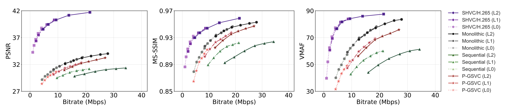
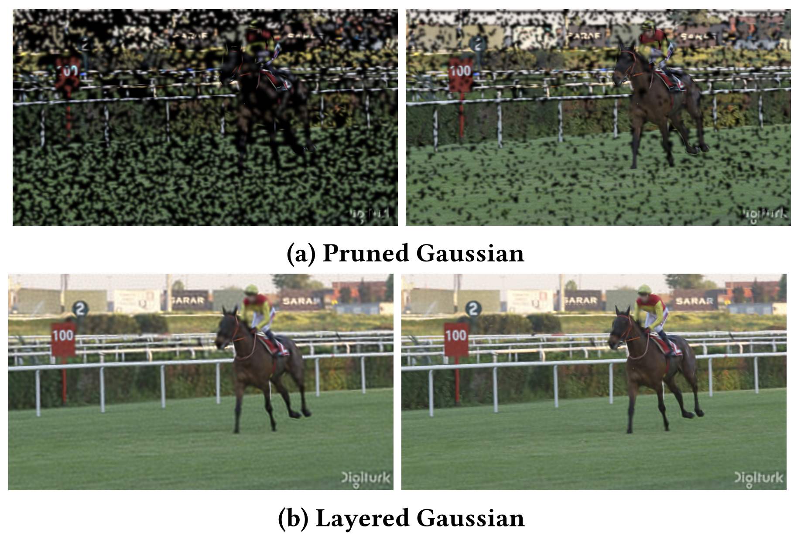

# P-GSVC: Layered Progressive 2D Gaussian Splatting for Scalable Image and Video
<!-- [](https://opensource.org/licenses/Apache-2.0)  -->
[](https://arxiv.org/html/2603.10551v1)


[[paper](https://arxiv.org/html/2603.10551v1)][[project page](https://longanwang-cs.github.io/PGSVC-webpage/)]
[[code](https://github.com/LonganWANG-cs/PGSVC)]

[Longan Wang](https://longanwang-cs.github.io/), [Yuang Shi](https://yuang-ian.github.io/), [Wei Tsang Ooi📧](https://www.comp.nus.edu.sg/~ooiwt/)
(📧 denotes corresponding author.)


This is the official implementation of our paper [P-GSVC](https://arxiv.org/abs/XXXX.XXXX).
In this work, we present P-GSVC, the first layered progressive 2D Gaussian splatting frame work that provides a unified solution for scalable Gaussian representation in both images and videos.
Our method organizes 2D Gaussian splats into a layered hierarchy, where the base layer reconstructs coarse structures and successive enhancement layers progressively refine details.
To effectively optimize this layered representation, we propose a joint training strategy that simultaneously updates Gaussians across layers while aligning their optimization trajectories, ensuring consistency and robustness throughout training.
This proposed model naturally supports progressive scalability in terms of both quality and resolution.
Extensive experiments on both image and video datasets demonstrate that P-GSVC achieves high visual quality, robust layer consistency, and reliable progressive reconstruction with less than 3% overhead compared to non-scalable baselines, and obtains nearly 50% gains compared to existing training strategies for layered Gaussians.
<figure style="text-align: center;">
  <div>
    
  </div>
  <figcaption><strong>Figure 1:</strong> Quantized rate–distortion results of P-GSVC versus baselines on UVG dataset in PSNR, MS-SSIM, and VMAF.</figcaption>
</figure>


<figure style="text-align: center;">
  <table style="margin: 0 auto;">
    <thead>
      <tr>
        <th colspan="12">UVG</th>
      </tr>
      <tr>
        <th colspan="4">L0</th>
        <th colspan="4">L1</th>
        <th colspan="4">L2</th>
      </tr>
      <tr>
        <th>Bpp</th>
        <th>PSNR</th>
        <th>MS-SSIM</th>
        <th>VMAF</th>
        <th>Bpp</th>
        <th>PSNR</th>
        <th>MS-SSIM</th>
        <th>VMAF</th>
        <th>Bpp</th>
        <th>PSNR</th>
        <th>MS-SSIM</th>
        <th>VMAF</th>
      </tr>
    </thead>
    <tbody>
      <tr>
        <td>0.085</td> <td>28.4</td><td>0.865</td><td>31.6</td> <td>0.169</td> <td>30.1</td><td>0.902</td><td>47.3</td> <td>0.247</td> <td>30.9</td><td>0.915</td><td>56.2</td>
      </tr>
      <tr>
        <td>0.106</td> <td>29.1</td><td>0.881</td><td>37.5</td> <td>0.208</td> <td>30.7</td><td>0.913</td><td>53.3</td> <td>0.306</td> <td>31.6</td><td>0.926</td><td>62.4</td>
      </tr>
      <tr>
        <td>0.127</td> <td>29.7</td><td>0.894</td><td>43.2</td> <td>0.251</td> <td>31.3</td><td>0.923</td><td>59.6</td> <td>0.369</td> <td>32.2</td><td>0.935</td><td>68.4</td>
      </tr>
      <tr>
        <td>0.145</td> <td>30.0</td><td>0.899</td><td>46.3</td> <td>0.289</td> <td>31.7</td><td>0.928</td><td>63.0</td> <td>0.423</td> <td>32.5</td><td>0.940</td><td>71.0</td>
      </tr>
      <tr>
        <td>0.166</td> <td>30.3</td><td>0.906</td><td>49.0</td> <td>0.328</td> <td>32.0</td><td>0.932</td><td>66.3</td> <td>0.480</td> <td>32.9</td><td>0.943</td><td>73.2</td>
      </tr>
      <tr>
        <td>0.187</td> <td>30.6</td><td>0.912</td><td>52.4</td> <td>0.370</td> <td>32.4</td><td>0.938</td><td>69.3</td> <td>0.541</td> <td>33.2</td><td>0.947</td><td>75.9</td>
      </tr>
    </tbody>
  </table>
  <figcaption><strong>Table 1:</strong> Rate-Distortion Metrics of P-GSVC on UVG in PSNR, MS-SSIM, and VMAF.</figcaption>
</figure>


## News

* **2025/2/1**: 🔥 We release our Python and CUDA code for GSVC presented in our paper. Have a try!

<!-- * **2025/2/1**: 🌟 Our paper has been accepted by NOSSDAV 2025! 🎉 Cheers! -->

## Insight
Existing 2DGS methods are primarily designed for image and video representation, without considering the challenges of scalable coding. As shown in Figure 2, simple pruning-based “layers” often introduce holes and bad visual quality. We therefore build a layered progressive 2DGS where the base layer keeps complete scene structure and higher layers only add details, supported by joint training to ensure consistent and robust progressive decoding.

<figure style="text-align: center;">
  <div>
    
  </div>
  <figcaption><strong>Figure 2:</strong>  Progressive reconstruction of (a) Pruned Gaussians and (b) Layered Gaussians (our P-GSVC). Both columns use the same number of Gaussians, and the quality improves from left to right as more Gaussians are added. Noticeable holes appear in (a), while (b) preserves scene integrity.</figcaption>
</figure>

## Overview

We propose P-GSVC, a layered progressive 2D Gaussian Splatting (2DGS) framework for scalable image and video. We organize Gaussians into multiple layers: the base layer captures the main structure of the scene, and enhancement layers progressively add details. To train the layered representation reliably, we use a joint training strategy. In each iteration, we optimize two targets in parallel: a full reconstruction using all layers, and an intermediate reconstruction using only layers up to a cyclically chosen level. This keeps lower layers reliable, and makes the quality improve smoothly in higher layers.


## Play with Our Code

### Cloning the Repository

```shell
# SSH
git clone https://github.com/LonganWANG-cs/PGSVC.git
```
or
```shell
# HTTPS
git clone git@github.com:LonganWANG-cs/PGSVC.git
```
After cloning the repository, you can follow these steps to train GSVC models under different tasks. 

### Requirements

We are using `python version 3.9` and `torch cuda runtime 12.4`. Before running the below code, please make sure `torch` is installed.

```bash
cd gsplat
pip install .[dev]
cd ../
pip install -r requirements.txt
```

If you encounter errors while installing the packages listed in requirements.txt, you can try installing each Python package individually using the pip command.

Before training, you need to download the [UVG](https://ultravideo.fi/dataset.html). 

### Manual Training Example
This repository provides scripts for video representation and compression (Encode and Decode) using Gaussian models. The workflow involves two key steps:

1. **Video Representation:** Overfit a video using Gaussian splatting to obtain a detailed model.
2. **Video Compression:** Compress the overfitted model to reduce file size while maintaining quality.

#### Step 1: Video Representation
Run `train_PGSVC_overfitting.py` to generate the overfitted model:

```bash
python train_PGSVC_overfitting.py \
  --dataset /home/data/UVG/Beauty/Beauty_1920x1080_120fps_420_8bit_YUV.yuv \
  --data_name Beauty \
  --num_points 12000 \
  --layer_number 3\
  --video_length 50\
  --iterations 50000 \
  --savdir PGSVC_overfit_result \
  --savdir_m PGSVC_overfit_model \
  --training_strategy sequential \
  --is_downsample \
  --is_GSP --is_GSA \
  --save_video
```

#### Step 2: Video Compression
Encode: 
Run `train_PGSVC_encoder.py` to compress the video using the overfitted model.

```bash
python train_PGSVC_encoder.py \
 --model_path /home/PGSVC/checkpoints/PGSVC_overfit_model/Beauty/PrGS_50000_12000_3/gmodels_state_dict.pth \
 --num_points 12000 \
--dataset /home/data/UVG/Beauty/Beauty_1920x1080_120fps_420_8bit_YUV.yuv \
--data_name Beauty\
--layer_number 3 \
--video_length 50 \
--iterations 50000 \
--savdir PGSVC_encode_result \
--savdir_m PGSVC_encode_model \
--save_video
```
Decode: 
Run `test_PGSVC_decoder.py` to decode the compressed Gaussian video.
```bash
python test_PGSVC_decoder.py \
 --model_path /home/PGSVC/checkpoints/PGSVC_encode_model/Beauty/PrGS_50000_12000_3/encoded_gmodels_state_dict.pth \
 --num_points 12000 \
--dataset /home/data/UVG/Beauty/Beauty_1920x1080_120fps_420_8bit_YUV.yuv \
--data_name Beauty\
--layer_number 3 \
--video_length 50 \
--iterations 50000 \
--savdir PGSVC_decoder_result \
--savdir_m PGSVC_decoder_model \
--save_video
```


## Acknowledgments

Our code was developed based on [GaussianImage](https://github.com/Xinjie-Q/GaussianImage) and [GSVC](https://github.com/LonganWANG-cs/GSVC). 
This is a paradigm of image representation and compression by 2D Gaussian Splatting.


<!-- ## Citation

If you find our GSVC useful or relevant to your research, please kindly cite our paper:

```
@article{wang2025gsvc,
  title={GSVC: Efficient Video Representation and Compression Through 2D Gaussian Splatting},
  author={Wang, Longan and Shi, Yuang and Ooi, Wei Tsang},
  journal={arXiv preprint arXiv:2501.12060},
  year={2025}
}
``` -->
